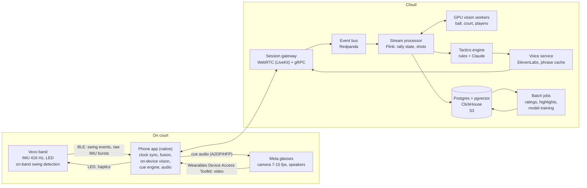

# Vexo Pickleball Coach: production architecture

This is the system we plan to build after the hackathon. It is a plan, not a description of running code: the hackathon prototype in this repo proves the core loop (band swing → cue → light, voice and overlay) on one laptop. The last section maps each prototype file to the production component that replaces it.

## What the product does

A player wears a Vexo motion band on the paddle wrist and Meta glasses. During a game the coach:

- **Judges every swing** from the band (contact timing, wrist speed, follow-through) and answers within a few hundred milliseconds: a light on the band and a short spoken cue.
- **Calls tactics** from what the glasses see: where the opponents stand, who is weak on which side, where the gap is ("Attack the backhand", "Lob her", "Go middle").
- **Remembers people.** Each opponent and partner gets a profile built from the games they played against the user, plus voice notes the user records after a game.
- **Shows it all in a phone app:** live match, the user's stats and rating, players, recaps and replays with the coaching drawn over the glasses' video.

## Design constraints

| Constraint | Target | Why |
| --- | --- | --- |
| Swing cue latency | under 150 ms from contact to light, under 400 ms to voice | A cue after the next shot is useless |
| Tactical call latency | under 1.5 s from the opponent's position to voice | Calls land between shots, not during them |
| Works with no signal | Swing cues and recording keep working offline | Courts have poor coverage |
| Battery | A 90-minute session on band, glasses and phone | A typical open-play session |
| Privacy | Nobody is tracked or profiled without opting in | Opponents never agreed to be recorded |

The latency targets decide the split below: anything on the swing path runs on the band and the phone, and the cloud only does work that can wait a second or more.

## System overview



## Components

### 1. Vexo band (firmware)

- **Swing detection on the band.** Move today's detector (gyro threshold to start, quiet period to end, largest acceleration jump for contact) into firmware. The band then sends one compact swing event per swing instead of a 416 Hz stream, which saves radio time and battery.
- **Raw bursts on request.** For training data and debugging, the phone can ask for the raw samples around a swing (about 0.5 s before to 0.5 s after).
- **Clock.** The band timestamps every event against a clock the phone resyncs every few seconds, so swings line up with video frames to within about 10 ms.
- **Feedback.** LED color and pattern per cue kind, plus haptics if the hardware has them. Blue stays reserved: the band shows solid blue while its microphone is on.

### 2. Meta glasses

- **Video in** through Meta's Wearables Device Access Toolkit (iOS and Android SDK), streamed to the phone at 504×896, 7-15 fps. This replaces the hackathon's WhatsApp-call workaround.
- **Audio out:** the glasses are the phone's Bluetooth headset, so cue audio plays through them with no special API.
- **Mic in** for voice notes ("Hey coach, Maya's backhand is weak") and wake-word commands.

### 3. Phone app (native: Swift on iOS, Kotlin on Android)

The phone is the real-time hub. It keeps working with no network.

- **Device links:** BLE to the band (Core Bluetooth / Android BLE) and the toolkit session to the glasses.
- **Clock sync and fusion:** puts swing events and video frames on one timeline.
- **On-device vision (Core ML / TFLite):** a small player and ball detector (YOLO-class) plus pose estimation at the camera's frame rate. It finds who is where and which side of the body the ball goes to.
- **Cue engine:** the rule table that turns a swing into a light and a line (today's `CUES` table, `coach.py`). It runs entirely on the phone, so swing cues never wait for the network.
- **Audio scheduler:** one voice at a time, with priority (a tactical call beats a "nice shot"). Common lines are cached as audio on the device.
- **UI:** the screens in `web/app/` (Live, Me, Players, Recap, player detail) rebuilt natively, plus the glasses HUD for demos and the companion view.
- **Offline queue:** events and clips are kept locally and uploaded when the phone is back online.

### 4. Real-time cloud

- **Session gateway:** WebRTC through LiveKit for video (adaptive bitrate, keyframes on demand) and gRPC streams for events. It handles authentication, session start and stop, and backpressure.
- **Event bus: Redpanda** (Kafka API). Topics: `swings`, `frames.detections`, `rally.state`, `shots`, `cues`, `notes`. Partitioned by match, so one match's events stay in order.
- **Stream processor: Apache Flink.** Joins swings with vision detections into shot events (who hit it, forehand or backhand, contact quality, where it landed) and keeps the rally state: score, server, positions, recent errors per player.
- **GPU vision workers** (NVIDIA Triton, on autoscaled GPU nodes or Modal) for the heavy models the phone can't run: ball trajectory, court mapping (homography from the court lines) and shot classification on short clips.
- **Tactics engine.** Two layers:
  - **Rules first.** Fast, testable patterns such as "opponent missed 3 of the last 4 backhands → attack the backhand", or "both opponents at the kitchen and the lob lane is open → lob".
  - **Claude for judgment and wording.** Claude (Claude Opus 5.5 at low effort for in-game calls) gets the rally state, both teams' profiles and the user's goals, and returns a structured call `{kind, line, why, target}`. The prototype's `ai_coach.py` already does this for swing cues.
  - **Cooldowns,** so the coach doesn't talk every shot.
- **Voice service:** ElevenLabs with a low-latency model and the coach voice, behind a phrase cache. A repeated line is a cache hit and plays instantly.

### 5. Data

| Store | Holds | Why this store |
| --- | --- | --- |
| **Postgres** | Users, players, matches, consent records, profiles, ratings | Relational, transactional |
| **pgvector** (in Postgres) | Embeddings of voice notes and tendencies ("lobs when pressed") | Semantic recall for briefings ("what do I know about Sean?") |
| **ClickHouse** | Every swing and every raw IMU burst, per-shot features | Fast analytics over billions of rows |
| **S3** (or R2) | Video clips, rendered highlight reels, model artifacts | Cheap blob storage, signed URLs to the app |
| **Redis** | Live session state, cooldowns, phrase-cache index | Low-latency shared state |

### 6. Batch and ML

- **Ratings.** A per-shot skill model produces skill scores (serve, drive, dink, reset...) and a **Vexo rating**, calibrated against DUPR where users link it.
- **Highlights.** Server-side rendering of the overlay on real, synced data, producing the replays in the app. The hackathon's `demo/` renderer is the prototype: it renders an HTML overlay frame by frame in headless Chromium, then encodes with ffmpeg.
- **Training pipeline.** Paired band and video data becomes labelled shots for the swing and vision models. Experiments are tracked in **MLflow**, and nightly jobs run on **Airflow** or **Dagster**.
- **Coaching evals.** A fixed set of rally states with expected calls. Every prompt or model change to the tactics engine is scored against it before release.

### 7. Platform

- **Consent and privacy.** Any player who is detected, profiled or rated must opt in through the app. Players who haven't opted in are blurred in stored clips and get no profile. Users can export and delete their data.
- **Infrastructure:** Kubernetes (EKS or GKE) for the gateway, Flink and the services; GPU node pools for vision; Terraform for everything.
- **Observability:** OpenTelemetry traces across phone, gateway, Flink and the tactics engine, with a latency budget per hop, viewed in Grafana. Alerts fire when cue latency passes its budget.
- **Release safety:** feature flags for new cue kinds and tactics rules, and staged rollouts of firmware and models.

## The two loops and their latency budgets

**Swing loop** (on the phone, no network):

| Step | Budget |
| --- | --- |
| Band detects contact and sends the swing event | 30 ms |
| BLE to the phone | 20 ms |
| Cue engine picks the cue | 5 ms |
| LED command back to the band | 30 ms |
| Cached audio starts in the glasses | 150 ms |
| **Total to voice** | **under 250 ms** |

**Tactics loop** (phone and cloud):

| Step | Budget |
| --- | --- |
| Frame to on-device detections | 80 ms |
| Upload detections and keyframes | 150 ms |
| Flink updates the rally state | 100 ms |
| Rules match, or Claude writes the call | 50 ms for rules, 800 ms for Claude |
| Voice (cache hit / generated) | 50 ms / 300 ms |
| Downlink and playback | 150 ms |
| **Total** | **0.6 s with rules, about 1.5 s with Claude** |

## Core data model

```text
Player         id, name, handedness, consent{tracked, profiled, rated}, avatar
Match          id, players[4], teams, started_at, court, score_log
Swing          id, match_id, player_id, t (band clock), peak_gyro, peak_accel,
               impact_vs_peak_ms, follow_ms, duration_ms, raw_ref?
Detection      match_id, frame_t, kind (player|ball|court), box, track_id, pose?
Shot           id, match_id, swing_id?, hitter_id, side (fh|bh), type (drive|dink|drop|lob|...),
               contact_quality, landing{x,y}, outcome (in|out|net|winner|error)
RallyState     match_id, point, server, positions{player_id:{x,y}}, recent_errors{player_id:[...]}
Cue            id, match_id, kind (fix|good|attack|team), line, why, target_player_id?,
               source (rules|ai), latency_ms, delivered{light, voice}
Note           id, author_id, about_player_id, text, embedding, created_at
Rating         player_id, as_of, skills{serve, drive, dink, ...}, vexo_rating, dupr?
```

The swing and cue shapes are the ones the prototype already streams (`coach.py` → `/events`), extended with match and player IDs.

## From prototype to production

| Prototype (this repo) | Production replacement |
| --- | --- |
| `swing.py` swing detector in Python on the laptop | Band firmware detection, with the same algorithm as the reference implementation and test oracle |
| `coach.py` cue table, LED and voice | Phone cue engine and audio scheduler |
| `coach.py` server-sent events on `/events` | gRPC event streams plus the Redpanda topics |
| `ai_coach.py` (Claude writes the swing line) | Tactics engine (rules + Claude), with evals and cooldowns |
| `render_voice.py` pre-recorded lines | Voice service with the phrase cache |
| WhatsApp call + browser screen capture | Wearables Device Access Toolkit in the native app |
| `web/hud.html`, `web/app/` | Native phone UI (and a web companion) |
| `demo/` frame-by-frame overlay renderer | Highlights service on real synced data |
| Sample data in Players, Recap and ratings | ClickHouse features, the ratings model and Postgres profiles |

## Build order

Each phase ships something a player can use, and each ends in a check against real games.

1. **Phone-native swing loop.** Port the cue engine and band link to iOS. Record 500 labelled swings and tune the thresholds on them. Check: under 250 ms to voice, and 90% agreement with a human coach on late versus on-time.
2. **Glasses video and clock sync.** Toolkit integration, a synced timeline, and local recording. Check: swing-to-frame alignment within 1 frame.
3. **Cloud pipeline and replays.** Gateway, Redpanda, Flink shots, S3 clips, and the highlights renderer on real data. Check: a full match produces correct shot events and a replay.
4. **Players and consent.** Opt-in flow, profiles, voice notes with pgvector recall, and player detail pages from real data.
5. **Tactics engine.** Rules first, then Claude, both gated by the coaching evals. Check: calls arrive in under 1.5 s, and the eval pass rate holds release over release.
6. **Ratings.** The per-shot skill model and the Vexo rating, calibrated against DUPR.

## Open questions

- **Firmware access:** can we ship custom firmware to Vexo bands, or do we stay on the stream API and detect on the phone?
- **Toolkit limits:** the glasses' frame rate and resolution caps, and whether the toolkit allows background streaming during a full session.
- **Opponent detection:** can we tell opponents apart reliably from a moving POV camera? This may need court mapping and jersey colors rather than faces.
- **Consent UX:** how a player who isn't using the app opts in on court in under 30 seconds.
- **Cost:** GPU vision and Claude calls per match hour, and how much of each can move onto the phone.
